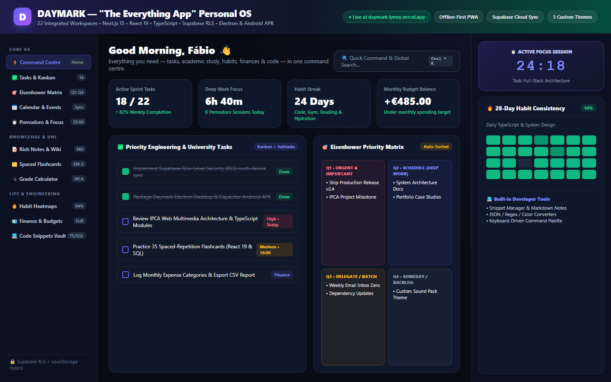

# Daymark ("The Everything App") — Personal Operating System & Command Centre

[](https://daymark-lynnx.vercel.app)
[](https://nextjs.org)
[](https://www.typescriptlang.org/)
[](https://supabase.com)
[](https://daymark-lynnx.vercel.app)

> **Live Web App (PWA):** [https://daymark-lynnx.vercel.app](https://daymark-lynnx.vercel.app)  
> **Author:** Fábio Júnior Fernandes Silva — BSc in Web Multimedia Development @ IPCA (Portugal)



**Daymark ("The Everything App")** is an all-in-one personal operating system engineered for desktop PCs, laptops, tablets, and mobile phones. It replaces disjointed single-purpose tools by unifying **22 integrated modules** — productivity, Kanban tasks, Eisenhower priority matrix, academic study tools, schedule, fitness, nutrition, personal finances, developer utilities, documents, travel plans, and an AI assistant — into a single, cohesive Progressive Web App (PWA), Windows Electron desktop app, and Android APK.

---

## 1. System Architecture & Tech Stack

- **Framework**: Next.js 15 (App Router)
- **UI / Core**: React 19, TypeScript (Strict Mode)
- **Design System & Styling**: Custom solid dark design tokens with Tailwind CSS (Strictly Zero Gradients)
- **Icons**: Lucide Icons
- **Data Persistence**: Local-First Resilient Architecture with IndexedDB / LocalStorage persistence + Supabase Cloud PostgreSQL integration
- **Security & Authorization**: Row Level Security (RLS) on all user-owned tables
- **Offline / PWA**: Installable Web App Manifest (`/manifest.json`), Service Worker (`/sw.js`) with app shell caching and offline fallback page (`/offline`)

---

## 2. Visual Direction & Design Tokens

Daymark strictly implements a solid dark theme with red accents:
- **Main Background**: `#0B0D10`
- **Sidebar Background**: `#101216`
- **Surface / Card Background**: `#16191F`
- **Elevated Surface**: `#1D2128`
- **Borders & Dividers**: `#2A2F38`
- **Primary Text**: `#F3F4F6`
- **Secondary Text**: `#A0A6B2`
- **Muted Text**: `#737B89`
- **Brand Red**: `#EF4444`
- **Red Hover**: `#DC2626`
- **Subtle Red Tint**: `rgba(239, 68, 68, 0.12)` (solid tint, zero gradients)

---

## 3. Core Modules & Features

### 1. Dashboard (`/`)
- Dynamic greeting and live clock respecting user timezone (`Europe/Lisbon` default)
- Today's tasks with inline checkbox completion and priority tags
- Habit streaks and one-tap daily mark
- Real-time weather observation powered by Open-Meteo API
- Daily calorie and macronutrient breakdown (calories, protein, carbs, fat)
- Hydration tracker with quick-add buttons (+250ml, +500ml) and undo
- Monthly expense summary and budget status

### 2. Schedule & Calendar (`/calendar`)
- Full interactive calendar supporting Month view and Agenda / List view
- Jump to today, month-to-month navigation
- Event scheduling with start/end time, location, category tags, and recurrence
- Event deletion with instant synchronization

### 3. Tasks & To-Dos (`/tasks`)
- Views: Today, Upcoming, Overdue, Completed, All Tasks
- Priority tags: Low, Medium, High, Urgent
- Actionable subtasks checklist per task
- Due date indicators with red overdue alerts
- CSV export for task archives

### 4. Habits & Routines (`/habits`)
- Daily, weekdays, and weekly schedules
- Schedule-aware streak calculation (skipping unscheduled days does not penalize streaks)
- Weekly matrix completion tracker
- Archive and deletion controls

### 5. Notes & Ideas (`/notes`)
- Fast Markdown and rich text editor
- Split view: searchable list with tag chips and full editor
- Auto-saving with visible save status
- Pinning, tagging, and trash protection

### 6. Personal Journal (`/journal`)
- Private daily reflection journal with date picker
- Mood tracking (Great, Good, Neutral, Tough, Awful)
- Daily highlights and gratitude bullet points

### 7. Focus & Pomodoro Timer (`/focus`)
- Deep work intervals (25m), short breaks (5m), and long breaks (15m)
- Suspension-proof timer (uses timestamp deltas to prevent background tab drift)
- Web Audio API synthesized completion chime
- Session history logging linked to active tasks

### 8. Fitness & Workouts (`/fitness`)
- Comprehensive exercise library filtered by muscle group (Chest, Back, Legs, Shoulders, Arms, Core, Cardio)
- Reusable workout routine templates
- Active workout session tracker with set-by-set weight and rep logging, set completion checkboxes, and rest countdown
- Total volume calculation (kg lifted) and workout history

### 9. Nutrition & Water (`/nutrition` & `/water`)
- Daily food diary broken into Breakfast, Lunch, Dinner, and Snacks
- Macronutrient breakdown (Protein, Carbs, Fat) against configured goals
- Hydration tracker with quick-add amounts (+250ml, +500ml, +750ml, custom amount, undo)
- Body measurement logs: Weight, waist, chest, body fat % with historical tracking

### 10. Live Weather (`/weather`)
- Live forecast powered by Open-Meteo API (no proprietary key required)
- Current temperature, feels-like, humidity, wind speed, precipitation, UV index
- Next 8-hours hourly predictions and 7-day outlook
- Preset cities (Lisbon, London, Paris, Berlin, Madrid, New York, Tokyo)

### 11. Everyday Calculators & Tools (`/tools`)
- Safe Scientific Calculator with operator precedence (sin, cos, tan, sqrt, history)
- Unit Converter (Length, Mass, Temperature)
- Currency Converter with base EUR exchange rates
- Date Difference & Age calculator
- Stopwatch with laps and sub-second precision
- International World Clocks

### 12. Personal Finance & Budgets (`/finance`)
- Decimal-safe monetary arithmetic (minor units / cents)
- Income and expense transactions with category and merchant tracking
- Monthly category budgets with progress bars and remaining limit indicators
- Savings goals with target dates and contribution tracking
- CSV export for spreadsheet analysis

### 13. Meal Planner (`/meal-planner`)
- Recipe book with prep/cook times, servings, macros, and ingredients
- Weekly meal planner calendar
- One-click "Send Ingredients to Groceries" button

### 14. Shopping Lists (`/shopping`)
- Multi-list shopping system
- Item quantity, unit, estimated price, category, and priority
- Running cart total and budget comparison
- Touch-friendly checkboxes for mobile devices

### 15. Reading & Learning Tracker (`/reading`)
- Tracks books, articles, courses, and research papers
- Status: Currently Reading, Up Next, Finished
- Progress percentage and page/chapter counters
- Key takeaways and personal reflections

### 16. Travel Planner (`/travel`)
- Trips with destination, dates, and budget
- Daily scheduled itinerary with activity times, locations, and costs
- Packing checklist categorized by clothing, toiletries, tech, and documents

### 17. Document Organiser (`/documents`)
- Private file archive with metadata, folder categories, tags, and search
- Supports PDF, images, and text document uploads and safe downloads

### 18. Saved Links & Bookmarks (`/links`)
- Categories: Read Later, Watch Later, Learn Later, Play Later, Research
- Favorites, tags, and one-click external links

### 19. Universal Quick Add (`⌘K` / `⌘B` / Floating Action Button)
- Fast modal accessible anywhere in the app to create tasks, events, notes, habits, expenses, foods, shopping items, or bookmarks.

### 20. Global Cross-Module Search (`⌘K`)
- Instant search indexing all tasks, calendar events, notes, habits, exercises, finances, recipes, reading items, shopping items, and links.

### 21. AI Personal Assistant (`/ai-assistant`)
- Structured natural language assistant
- Structured validated actions (AI drafts a task or grocery item, user accepts with 1 click)
- Clear configuration banner when external API key is needed

### 22. Settings & Data Backups (`/settings`)
- User profile and regional preferences (Currency, Timezone, Units, Time format)
- Persistent Module Registry toggles (show/hide any module from navigation)
- Full JSON Database Backup export and schema-validated restore

---

## 4. Setup & Running Locally

### Prerequisites
- Node.js 18+ (tested on Node v24)
- npm 10+

### Installation
```bash
git clone <repo-url>
cd "The Everything App"
npm install
```

### Environment Configuration
Copy the template environment file:
```bash
cp .env.example .env.local
```
Fill in credentials if connecting to remote Supabase or AI:
```env
NEXT_PUBLIC_APP_URL=http://localhost:3000
NEXT_PUBLIC_SUPABASE_URL=https://your-project.supabase.co
NEXT_PUBLIC_SUPABASE_ANON_KEY=your-anon-key
AI_API_KEY=your-openai-or-groq-key
```
*(Note: When remote credentials are not set, Daymark runs in local-first offline resilient mode with complete functionality!)*

### Database Migrations
Supabase PostgreSQL schema and Row Level Security policies are located in:
`supabase/migrations/20261028000000_daymark_schema.sql`

To apply to your Supabase project:
1. Open your Supabase Dashboard -> **SQL Editor**.
2. Paste the contents of `supabase/migrations/20261028000000_daymark_schema.sql` and run.

### Running Development Server
```bash
npm run dev
```
Open [http://localhost:3000](http://localhost:3000) in your browser.

### Typecheck & Production Build
```bash
npm run typecheck
npm run build
npm run start
```
